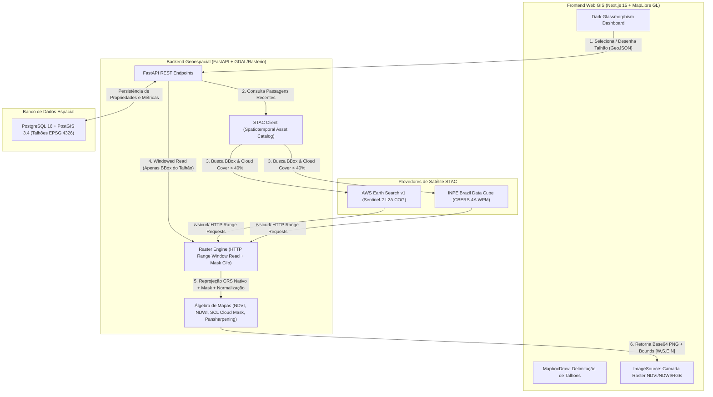

# 🛰️ ValeSat Agro

Plataforma SaaS Agrotech cloud-native de monitoramento satelital de altíssima precisão desenvolvida especialmente para os desafios topográficos e climáticos do **Vale do Itajaí (Santa Catarina, Brasil)** — combinando o ciclo constante de 5 dias do **Sentinel-2 (10m)** com a nitidez submétrica/alta resolução do **CBERS-4A WPM (2m/8m INPE)** com pansharpening em memória e leitura parcial via *HTTP Range Requests (Zero Full Download)*.

---

## 🏛️ Arquitetura do Sistema



---

## 🛰️ Motores Satelitais Integrados

| Recurso | Motor 1: Sentinel-2 (ESA / AWS) | Motor 2: CBERS-4A WPM (INPE BDC) |
| :--- | :--- | :--- |
| **Resolução Espacial** | 10 metros | 2 metros (Pansharpened) / 8m (Multiespectral) |
| **Taxa de Revisita** | 5 dias | ~31 dias (Alta Resolução Local) |
| **Bandas Utilizadas** | B02 (Azul), B03 (Verde), B04 (Vermelho), B08 (NIR), SCL | BAND0 (Pan 2m), BAND1 (Azul), BAND2 (Verde), BAND3 (Vermelho), BAND4 (NIR) |
| **Índices Suportados** | NDVI, NDWI, RGB Natural, Máscara de Nuvem SCL no Talhão | RGB Pansharpened (Fusão Brovey/IHS), NDVI Alta Resolução |
| **Mecanismo de Leitura** | Cloud Optimized GeoTIFF (COG) via HTTP Range | COG / GDAL VSI via Servidor INPE com fallback resiliente |

---

## ⚡ Inicialização Rápida com Docker

Suba todo o ecossistema (PostgreSQL/PostGIS, FastAPI e Next.js) com um único comando:

```bash
docker compose up --build
```

### URLs Locais de Acesso:
* **Frontend Web GIS:** [http://localhost:3000](http://localhost:3000)
* **Documentação Interativa Swagger (FastAPI):** [http://localhost:8000/docs](http://localhost:8000/docs)
* **Endpoint de Saúde dos Motores STAC:** [http://localhost:8000/api/health](http://localhost:8000/api/health)

---

## 🌾 Propriedade Principal Pré-Cadastrada (Seed)
* **Casa da Lagoa (Propriedade Principal):** Rua Reinhold Schroeder, Blumenau / Gaspar - SC
  * Coordenadas: `26°58'12.1"S 49°10'31.2"W` (`-26.970028, -49.175333`)
  * Link direto: [Google Maps Casa da Lagoa](https://maps.app.goo.gl/2tqWsce6YtS9DoGm9?g_st=ic)
