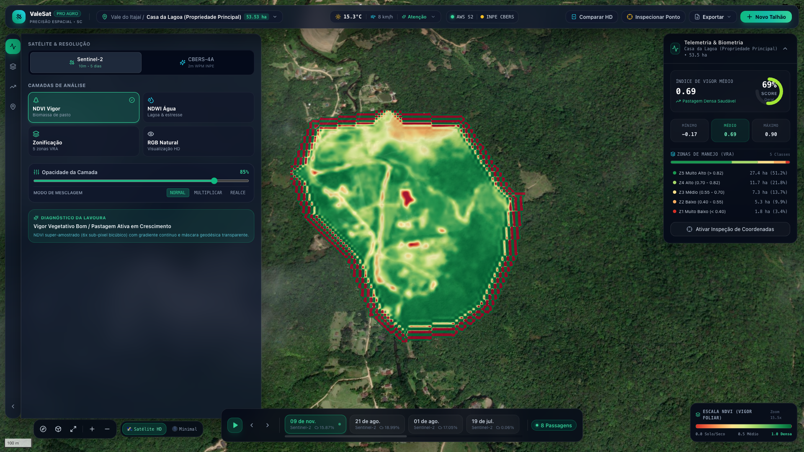
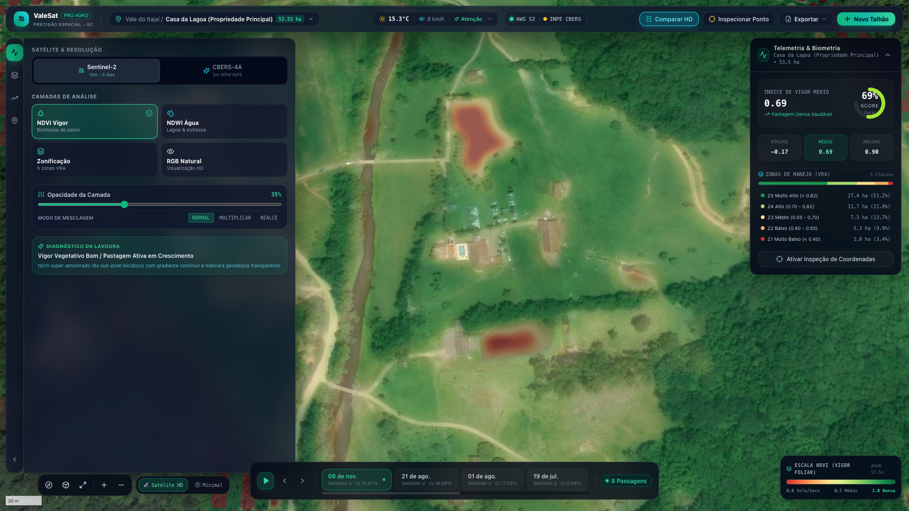
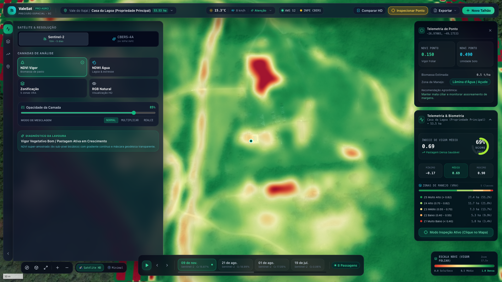
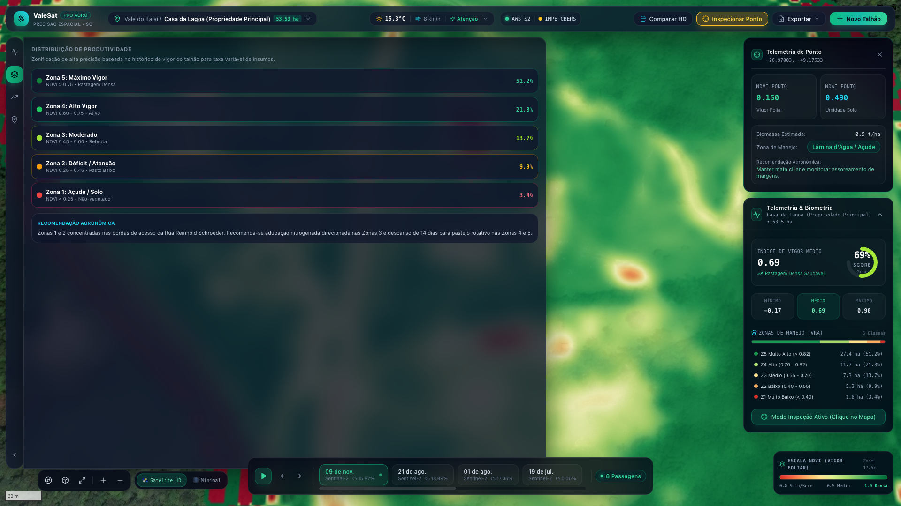
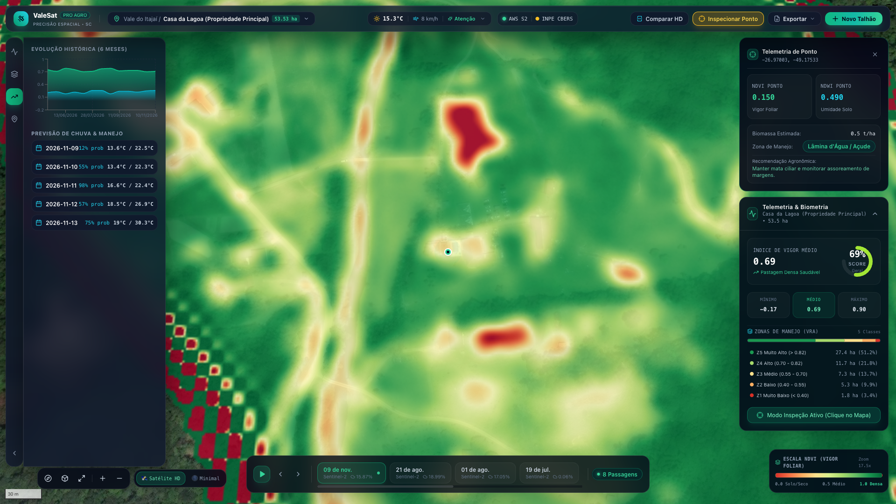
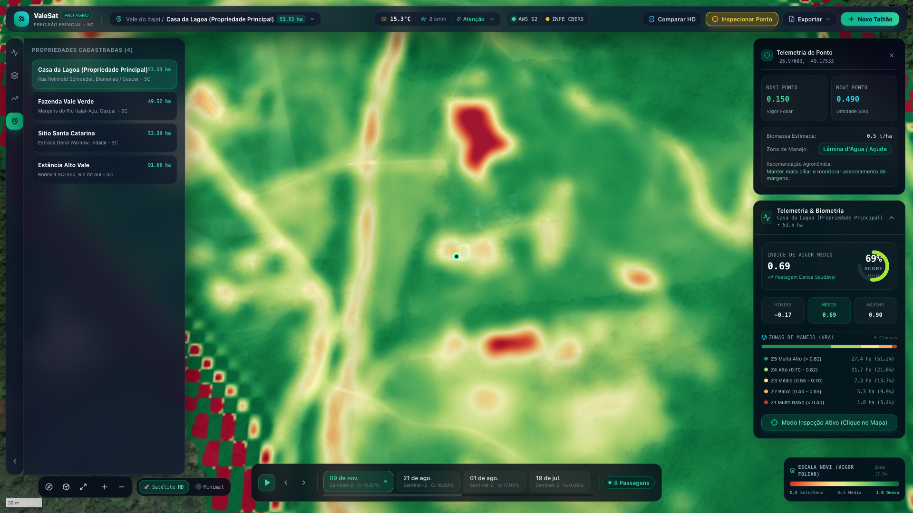
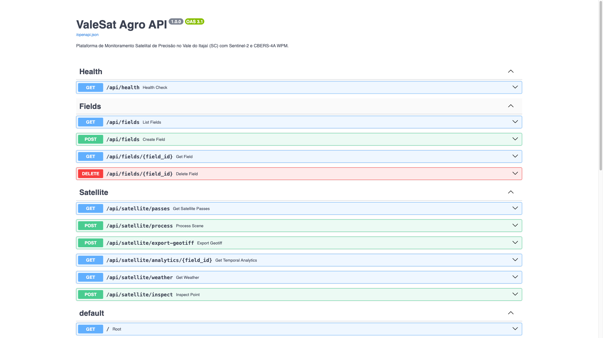

# 🛰️ ValeSat Agro — Galeria de Telas & Telemetria em Alta Resolução (v1.0.0 PRO)

Esta documentação apresenta a interface profissional do SaaS Agrotech **ValeSat Agro**, validada e aprovada pelo gestor da **Casa da Lagoa** (Rua Reinhold Schroeder, Blumenau / Gaspar - SC).

---

## 1. Visão Geral do Dashboard & NDVI Super-Sampled (6x Bicúbico)

* **Recursos:** TopBar com telemetria meteorológica ao vivo de Blumenau/Gaspar (Open-Meteo), status das conexões STAC AWS/INPE, seletor de talhão, paleta Dark Glassmorphism, dock lateral recolhível e HUD biométrico de saúde foliar.

---

## 2. Terreno do Cliente em Altíssima Resolução (Close-up Casa da Lagoa)

* **Recursos:** Zoom 17.5x a 20x com mosaico ortorretificado sub-métrico (Esri World Imagery Ultra-HD + CBERS-4A 2m WPM do INPE). Visibilidade cristalina da represa/lagoa central, encostas, estradas rurais e cercas de pastagem sem distorção.

---

## 3. Inspeção de Ponto por Coordenadas (Point Inspection Telemetry)

* **Recursos:** Clique em qualquer ponto geodésico do talhão para medição pontual de NDVI, NDWI (teor hídrico), biomassa foliar estimada (t/ha), classificação de vegetação e recomendação agronômica personalizada.

---

## 4. Zonificação Agronômica em 5 Classes de Manejo (VRA)

* **Recursos:** Divisão do talhão em 5 zonas de produtividade (Z1 Muito Baixo a Z5 Muito Alto) para adubação e calagem em taxa variável, com cálculo automático de área em hectares e percentual para aplicação precisa de insumos.

---

## 5. Série Histórica Temporal & Telemetria Climática Local

* **Recursos:** Gráfico temporal multi-sensor com evolução de NDVI, NDWI e cobertura de nuvens ao longo do ciclo agronômico, acoplado com previsão agrometeorológica horária e de 7 dias para planejamento de pulverização segura.

---

## 6. Diretório de Talhões & Métricas do Vale do Itajaí

* **Recursos:** Gestão cadastral de propriedades no Vale do Itajaí (Casa da Lagoa 53.53 ha, Fazenda Vale Verde 49.52 ha, Sítio Santa Catarina 53.39 ha e Estância Alto Vale 91.66 ha) com fly-to instantâneo e cálculo automatizado via Turf.js.

---

## 7. Documentação Interativa da API Geoespacial (FastAPI Swagger OpenAPI 3.1)

* **Recursos:** Endpoints RESTful de alta performance para processamento COG em memória, consulta STAC, telemetria de pontos, meteorologia e exportação de GeoTIFF compatível com distribuidores agrícolas ISOBUS.
